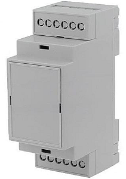

# DIN Rail Power Meter (9 channels)

This is a **9 channel**, 3 phase power meter designed to fit in a 2 module wide
DIN enclosure.

The device can be used on 3-phase systems, there are 3 current channels for
every phase (a total of 9 channels).
It can also be used on a 1-phase system as well.

On the front there is a small OLED display that can display the metering
information.

The project is inspired from: https://github.com/CircuitSetup/Expandable-6-Channel-ESP32-Energy-Meter

If you are looking for the easiest way to **start using your display
under Home Assistant:** ***[Home Assistant Quick Start Guide](HomeAssistant.md)***

## Hardware

The hardware uses the PCBs, one for the measurement and one for power,
that fits into a D2MG 2 module width DIN rail enclosure.

More information about the hardware can be found in the
**[hardware](hardware/README.md)** folder.

## ESPHome

The meter uses an ESP32-S3 controller and ESPHome as it's firmware.

More information about the ESPHome firmware can be found in the
**[esphome](esphome/README.md)** folder.