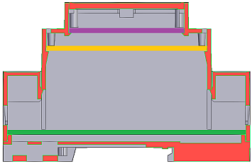
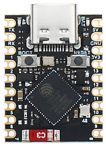

# DIN Rail Power Meter (9 channels) - Hardware

## PCB Size

The D2MG box can house PCBs on three levels.

The green board is the main metering board (32.7mm x 86.5mm) with the
ATM90E32 ICs and the voltage and CT input terminals.

The orange board is the power supply board (32.7mm x 58.3mm), with the 3.3V
DC power supply, and the protection varistors for the high-voltage AC input.

The purple board is a 3D printed plastic part that holds the OLED display.

## Schematics

The circuit is based on the Application Note of the [ATM90E32](https://www.microchip.com/en-us/product/ATM90E32AS).

[schematics.pdf](schematics.pdf)

It's a 3-phase measurement IC, but in this circuit it is used in a one phase
configuration. There are 3 IC each measuring one phase, so 3-phase meauserement
can still be achieved.

For **1-phase operation** you need to connect the same phase to all 3 inputs.
You can use all 9 current channels to measure circuits on this phase.

| Voltage input | Phase | Current channels |
| ------------- | ----- | ---------------- |
| L1, L2, L3    | L1    | 1-9              |

For **3-phase operation** you need to connect all 3 phases. And you can measure
3 circuits per phase (a total of 9 circuits).

| Voltage input | Phase | Current channels |
| ------------- | ----- | ---------------- |
| L1            | L1    | 1-3              |
| L2            | L2    | 4-5              |
| L3            | L3    | 7-9              |

### Voltage measurement

> [!CAUTION]
> The voltage is measured by a voltage divider network, so the circuit is not
> isolated from the mains, so it is not safe to tuch any part of the board
> during use, nor connecting the device with other electrical interfaces
> without proper isolation!
> The AC neutral is connected to DC ground, so treat the circuit as you would
> with any live circuit!

Phase voltage is sampled over a resistor divider network with
recommended ratio of 7 x 240 kΩ : 1 kΩ.

### Current measurement

Current is measured with current transformers (CT).

## WiFi Controller

The PCB is designed to accomodate an ESP32-S3 SuperMini controller.

The ATM90E32 ICs are controller over SPI, they are all connected to the
controller, along with the IRQ0 pin of every IC.

The 0.96" OLED display is controlled via I2C.

There is a built-in RGB status LED on the ESP32-S3's PCB,
although it's not visible from outside the enclosure.

The default firmware is ESPHome, you can find the configuration to it in the
[esphome](../esphome/README.md) folder.

### GPIO Pinout

| Pin    | Function             |
| ------ | -------------------- |
| GPIO9  | SPI MOSI             |
| GPIO10 | SPI MISO             |
| GPIO12 | SPI SCLK             |
| GPIO11 | SPI CS IC1           |
| GPIO2  | SPI CS IC2           |
| GPIO4  | SPI CS IC3           |
| GPIO5  | I2C SCL              |
| GPIO6  | I2C SDA              |
| GPIO13 | IC1 IRQ              |
| GPIO1  | IC2 IRQ              |
| GPIO3  | IC3 IRQ              |
| GPIO48 | Status Led           |

### Status LED

| Color           | State |
| --------------- | ----- |
| Red Blinking    | Errored state |
| Red             | Powered, not connected to WiFi |
| Blue            | Connected to WiFi |
| Green           | Native API connected |
